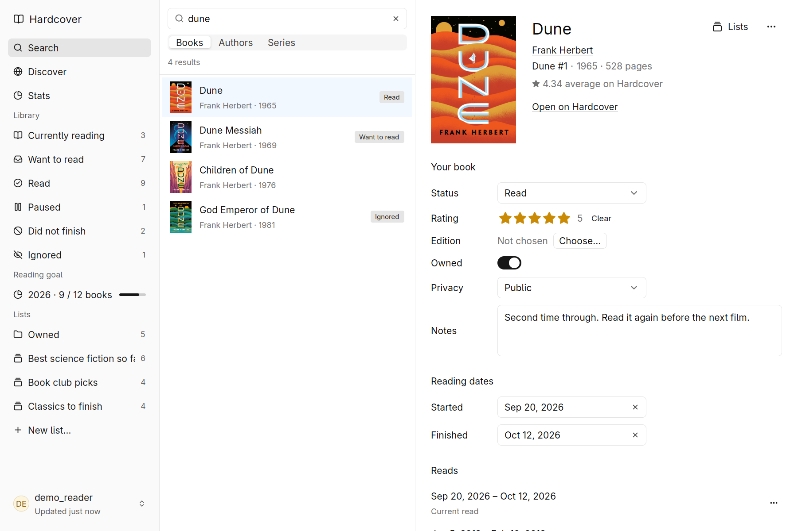
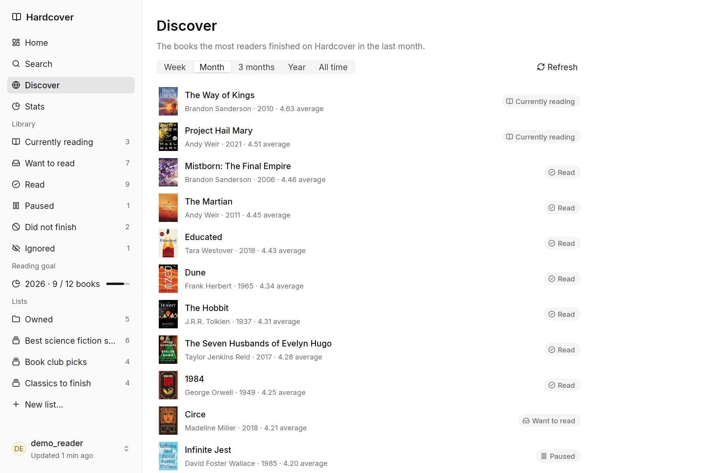

<p align="center">
  
</p>

<h1 align="center">Hardcover Desktop</h1>

<p align="center">
  An unofficial Linux desktop client for <a href="https://hardcover.app">Hardcover</a>, the social reading tracker.
</p>

<p align="center">
  <a href="https://github.com/AliSayyah/hardcover-desktop/actions/workflows/ci.yml"></a>
  <a href="https://github.com/AliSayyah/hardcover-desktop/releases/latest"></a>
  <a href="LICENSE"></a>
</p>

Hardcover Desktop is a native app built with Rust and [GPUI](https://gpui-kit.com). It keeps your library close at hand. You can browse your shelves, find and add books, rate them, and log your progress without opening a browser.

> [!NOTE]
> This is a community project. It is not made by, affiliated with, or endorsed by Hardcover.

<picture>
  <source media="(prefers-color-scheme: dark)" srcset="docs/screenshots/library-dark.png">
  
</picture>

## Features

- **Home:** the books you're reading, with your pace and when each should be done at it, your reading goal and whether you're on track, and what to read next, such as the next book in a series you've started.
- **Your library by shelf:** Currently Reading, Want to Read, Read, Paused and Did Not Finish, with counts in the sidebar, plus the books you ignored.
- **Search:** find any book, author or series on Hardcover, and add books to a shelf.
- **Discover:** the books the most readers finished on Hardcover this week, month, three months, year or of all time, each with its shelf.
- **Book details:** the authors and other contributors, series, page count, average rating, description, ratings breakdown, genres, moods and content warnings, and similar books.
- **Series and authors:** open a book's series to see its books in reading order and how many you've read, or an author to see their most-read books, each with its shelf.
- **Your reading:** set the status and rating, update your progress in pages (or time, for an audiobook), set the dates you started and finished, or remove a book.
- **Your copy:** choose the edition you read, keep private notes, choose who can see the book, and mark it owned or not (your Owned list on Hardcover).
- **Every read:** see each time you read a book, add a re-read or an earlier read, change its dates, or delete it.
- **Your review:** write a review of a book in your library, in Markdown, mark it as containing spoilers and date it; change or delete it later. A review written on the website is shown here and edited there.
- **Reading goals:** see this year's goal and your pace in the sidebar, and set, change or delete a goal of books, pages or hours.
- **Lists:** open your lists from the sidebar to see their books in order, create, edit or delete a list, and put a book on your lists or take it off from its page.
- **Stats:** books and pages you finished each year, re-reads included, how long a book takes you, how you rate and what is on each shelf, worked out from your library without going online.
- **Offline access:** your library and covers are cached on your computer, so they open instantly and stay readable without a connection.
- **Secure sign-in:** you sign in through Hardcover in your browser (OAuth with PKCE). The app never sees your password, and the session is stored in your system keyring.
- **Updates:** the app tells you about each new release. Installed under `~/.local` (by the installer, or the tarball unpacked by hand), it installs the release in one click, after verifying its signature.
- **Settings:** choose a light or dark theme or follow the system, and turn automatic update checks on or off.

<picture>
  <source media="(prefers-color-scheme: dark)" srcset="docs/screenshots/search-dark.png">
  
</picture>

- **Keyboard first:**

  | Shortcut | Action |
  | --- | --- |
  | <kbd>Ctrl</kbd>+<kbd>0</kbd> | Home |
  | <kbd>Ctrl</kbd>+<kbd>F</kbd> | Search |
  | <kbd>Ctrl</kbd>+<kbd>1</kbd>…<kbd>6</kbd> | Go to a shelf |
  | <kbd>Ctrl</kbd>+<kbd>Shift</kbd>+<kbd>D</kbd> | Discover |
  | <kbd>Ctrl</kbd>+<kbd>Shift</kbd>+<kbd>R</kbd> | Series |
  | <kbd>Ctrl</kbd>+<kbd>Shift</kbd>+<kbd>S</kbd> | Stats |
  | <kbd>Ctrl</kbd>+<kbd>R</kbd> | Refresh the library |
  | <kbd>Esc</kbd> or <kbd>Alt</kbd>+<kbd>←</kbd> | Back from a series, author or book page |
  | <kbd>Ctrl</kbd>+<kbd>,</kbd> | Settings |
  | <kbd>Ctrl</kbd>+<kbd>Q</kbd> | Quit |

<picture>
  <source media="(prefers-color-scheme: dark)" srcset="docs/screenshots/discover-dark.png">
  
</picture>

## Install

Every release on [GitHub](https://github.com/AliSayyah/hardcover-desktop/releases/latest) comes in three forms for x86_64 Linux, all the same app:

| | Updates | Needs |
| --- | --- | --- |
| [Installer](#installer) (`~/.local`) | in the app, in one click | glibc 2.35 or newer (Ubuntu 22.04, Debian 12, Fedora 36 and later) |
| [AppImage](#appimage) | download the new file | glibc 2.35 or newer |
| [Flatpak](#flatpak) | install the new bundle | Flatpak; the runtime comes from Flathub |

Each also needs Wayland or X11, Vulkan or OpenGL graphics drivers, and a Secret Service keyring, such as GNOME Keyring or KWallet, to store your sign-in.

### Installer

```sh
curl -fsSLO https://raw.githubusercontent.com/AliSayyah/hardcover-desktop/master/install.sh
bash install.sh
```

It downloads the latest release, checks its signature, and installs `~/.local/bin/hardcover-desktop` with its desktop entry and icon, so **Hardcover Desktop** appears in your app launcher. It needs no sudo. Installed this way, the app keeps itself up to date. To check the signature it uses your `minisign`, or downloads minisign's own release and checks its checksum.

To install a tarball you already have, put its `.minisig` next to it and run `bash install.sh hardcover-desktop-<version>-x86_64-linux.tar.gz`. Or unpack it yourself, to the same place:

```sh
mkdir -p ~/.local
tar -xzf hardcover-desktop-*-x86_64-linux.tar.gz -C ~/.local --strip-components=1
```

To uninstall, delete these:
- `~/.local/bin/hardcover-desktop`
- `~/.local/share/applications/io.github.alisayyah.HardcoverDesktop.desktop`
- `~/.local/share/icons/hicolor/scalable/apps/io.github.alisayyah.HardcoverDesktop.svg`
- `~/.local/share/metainfo/io.github.alisayyah.HardcoverDesktop.metainfo.xml`
- `~/.local/share/licenses/hardcover-desktop/`

### AppImage

Download the `.AppImage`, make it executable and run it:

```sh
chmod +x hardcover-desktop-*-x86_64-linux.AppImage
./hardcover-desktop-*-x86_64-linux.AppImage
```

Without FUSE, add `--appimage-extract-and-run`. To update, replace the file with the new release's; to uninstall, delete it.

### Flatpak

Download the `.flatpak` bundle, then install and run it:

```sh
flatpak install --user hardcover-desktop-*-x86_64-linux.flatpak
flatpak run io.github.alisayyah.HardcoverDesktop
```

Flatpak offers to install the Freedesktop runtime from Flathub the first time. To update, install the new release's bundle the same way. To uninstall, run `flatpak uninstall --user io.github.alisayyah.HardcoverDesktop`.

### Checking a download

Every download, the installer included, has a `.minisig` signature next to it on the release. To check a file yourself with [minisign](https://jedisct1.github.io/minisign/), download its `.minisig` into the same directory and run:

```sh
minisign -Vm <file> -P RWQmH1HvOAVP+8piXBk3ZC+nqzBVFZFcynEg8NUsgQDCSYYAkrSkPRXW
```

## Your data

The app talks to Hardcover's API, and to GitHub to check for updates. It stores the following on your computer:

| What | Where |
| --- | --- |
| Sign-in session | System keyring, service `hardcover-desktop` |
| Library cache | `~/.local/share/hardcover-desktop/` |
| Cover images | `~/.cache/hardcover-desktop/covers/` |
| Settings | `~/.config/hardcover-desktop/settings.json` |

The Flatpak keeps the library cache, covers and settings under `~/.var/app/io.github.alisayyah.HardcoverDesktop/` instead; the session is in the same keyring.

Signing out (account menu → **Sign out…**, or in **Settings**) revokes the session and deletes the library cache; your settings stay. To turn off automatic update checks, switch them off in **Settings**, or set `HARDCOVER_NO_UPDATE_CHECK=1`. **Check for updates** in the account menu still works.

## Build from source

You need Rust (the toolchain is pinned in `rust-toolchain.toml` and installs automatically with [rustup](https://rustup.rs)), plus a few system libraries.

On Debian or Ubuntu, install them with:

```sh
sudo apt install build-essential pkg-config libdbus-1-dev libfontconfig-dev libxcb1-dev libxkbcommon-x11-dev
```

On other distributions, install the equivalents: D-Bus, Fontconfig, xcb and xkbcommon-x11 development packages.

Then:

```sh
cargo run -p hardcover-desktop                # run the app
cargo test --workspace                        # run the tests
cargo build --profile dist -p hardcover-desktop  # optimized, stripped build
```

To try the app without an account, build it with the `demo` feature:

```sh
cargo run -p hardcover-desktop --features demo
```

It shows a sample library of popular books for a reader called `demo_reader`. The books come with their real covers, downloaded from Hardcover; that is the only thing the demo fetches. It never reads your keyring, cache or settings, and edits are refused. The screenshots above come from it.

The workspace has two crates:
- `crates/hardcover-core`: the Hardcover GraphQL client, OAuth sign-in, the library and cover caches, and self-update. It has no GUI code.
- `crates/app`: the GPUI interface.

[CLAUDE.md](CLAUDE.md) has more on the architecture, API quirks and release process.

## Contributing

Issues and pull requests are welcome. CI runs rustfmt, clippy (`-D warnings`), the tests and `cargo deny`, so it saves a round trip to run them locally first:

```sh
cargo fmt --all
cargo clippy --workspace --all-targets -- -D warnings
cargo test --workspace
```

With [just](https://github.com/casey/just) installed, `just check` runs all three (formatting is checked, not applied), and `just` lists the other tasks: the demo, the release tarball, `cargo deny`, packaging validation.

## Licence

[MIT](LICENSE). Hardcover is a trademark of its owners; this project only uses its public API.

The bundled fonts are under the SIL Open Font License: [Inter](https://rsms.me/inter/) ([licence](assets/fonts/inter/LICENSE.txt)), [Literata](https://github.com/googlefonts/literata) ([licence](assets/fonts/literata/LICENSE.txt)) and [Vazirmatn](https://github.com/rastikerdar/vazirmatn) ([licence](assets/fonts/vazirmatn/LICENSE.txt)).
